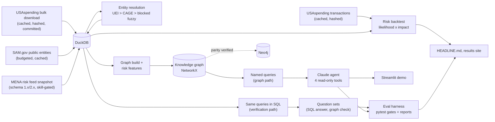

# Defense supplier-risk graph

**Problem.** A sustainment analyst (fictional persona) asks: *which of our contracts depend on suppliers that are
concentrated, sole-sourced or geographically exposed, and what breaks if one of them fails?*

**Built.** From public USAspending data (57,596 DoD maintenance contracts, $225.2B, 11,658 suppliers):
entity resolution with an end-to-end test, a knowledge graph checked against SQL and Neo4j, a time-split backtest of
the risk flags, and a Claude agent with four read-only tools that cites a record ID for every fact or declines.
Every part has an evaluation, and every number comes from a `make` target ([HEADLINE.md](reports/HEADLINE.md)).

**Three findings**
1. **The flags measure impact, not likelihood.** Against next-year contract terminations they score ROC-AUC 0.635,
   below simply counting contracts (0.758). Sole-source suppliers are *less* likely to see one: size-adjusted odds
   ratio 0.66 [0.52, 0.82]. The tool therefore shows likelihood and impact on separate axes.
2. **Grounding is the agent's failure mode.** With named, verified queries even the small model answers every
   structured question. It fails on a company name one word off: Haiku caught 1/8, 3/8, 3/8 look-alike traps. A
   check in the name-lookup tool (not the prompt) raised that to 7/8, 8/8, 7/8.
3. **Pairwise ER metrics overstate.** Matching scored above 0.9 on labelled pairs, yet resolved only 55.8% of renamed
   companies end to end. Facility-address blocking and learned evidence weights took it to 82.7%; a stricter
   operating point then cut false merges of absent companies 8.7% → 4.4%.

**Quickstart (offline: cached public data, no API key)**
```bash
make install && make offline   # rebuild DuckDB, graph, backtest and the results site from data/cache
open site/index.html           # the interview walkthrough (arrow keys move between sections)
make app                       # Streamlit demo; only the "Ask the agent" tab needs ANTHROPIC_API_KEY in .env
make test                      # regression gates
```

> Portfolio project on public data (USAspending, SAM.gov, and a country-risk feed from a separate personal project;
> its skill status is `beats_base_rate`, but the backtest couldn't test it, so it is context only). The persona is fictional. Not used by, endorsed by,
> or built for the DoD or any company. Total Claude API spend: $9.01.

---

## Results

| Area | Result | Report |
|---|---|---|
| Scope | DoD prime contracts + subawards, PSC **J** (maintenance, repair, rebuild), FY2023-FY2025: 57,596 awards, 35,842 subawards, 11,658 suppliers, 9,096 parents, 757 offices; 187,320 transactions FY2022-FY2025 for the backtest | [graph_summary.json](reports/graph_summary.json) |
| Entity resolution | Pairwise (test split, identifiers hidden): identifier-derived P 0.949 / R 0.909, synthetic P 0.954 / R 1.000, acronym recall 0.10 → 1.00. End to end (620 renamed records, UEI withheld): correct links 55.8% → 82.7%. Shipped operating point chosen on one half of those records, confirmed on the other: absent-company false links 8.7% → 4.4%, wrong links 3.8% → 0.6%, correct 83.6% → 78.5% | [entity_resolution.md](reports/entity_resolution.md) |
| Graph | 6 node labels, 6 edge types, provenance everywhere; 10 named queries in graph and SQL with exact agreement; Neo4j parity on all counts and a Cypher blast radius (30/30) | [neo4j_parity.json](reports/neo4j_parity.json) |
| Risk backtest | 5,541 test supplier-years, 145 events. ROC-AUC: flags 0.635, contract count 0.758, model 0.772 (gain over size +0.013 [-0.013, 0.039]; average precision +0.070 [0.028, 0.110]). Concentrated 3.06 → 0.77 after size; geo-exposed 1.75 → 1.00 without one Navy office in Japan | [risk_backtest.md](reports/risk_backtest.md) |
| Agent, v1 (101 questions) | Opus 87/88 answerable, 13/13 refusals, 0 fabricated IDs; Haiku 83/88, 83/88, 83/88 | [eval_report.md](reports/eval_report.md) |
| Agent, challenge (38 + 14 traps) | Opus 38/38 and 13/14; Haiku 38/38, 38/38, 38/38 but traps 7/14, 9/14, 9/14; Haiku + guard traps 13/14, 14/14, 13/14; Opus with no tools 0/38 (declines, invents nothing). Haiku costs 1/49 of Opus per question | [comparison.md](reports/comparison.md) |
| Trust | LLM judge validated on planted errors: 40/40 blatant, 30/30 subtle | [judge_validation_subtle.json](reports/judge_validation_subtle.json) |

## Architecture



Docs: [design doc](docs/design_doc.md) · [problem statement](docs/problem_statement.md) ·
[requirements](docs/requirements.md) · [one-page brief](docs/brief.md) · [runbook](docs/runbook.md) ·
[demo script](docs/demo_script.md) · [interview walkthrough](docs/INTERVIEW_WALKTHROUGH.md) ·
[likelihood model card](docs/model_card_likelihood.md) · [data licenses](docs/DATA_LICENSES.md)

## All commands

```bash
cp .env.example .env              # only for live agent runs (ANTHROPIC_API_KEY) or refreshing data
make install                      # venv + package (BOOTSTRAP_PY=python3.12 to pick the interpreter)
make data graph                   # pull (cache hit) -> DuckDB -> entity resolution (+ end-to-end test) -> graph
make backtest                     # transactions (cache hit) -> time-split backtest -> FY2026 outlook
make eval-offline compare-offline guard-eval   # re-score the committed agent runs (no API calls)
make headline site                # reports/HEADLINE.md, site/index.html
make test                         # regression gates; the Neo4j parity test runs when `make neo4j-up neo4j-load` has run
make eval                         # full live agent run (~$3, budget-guarded)
make feed-snapshot                # refresh the MENA feed snapshot from MENA_RISK_FEED_PATH
```

Two consecutive builds give identical reports apart from timestamps; a fresh clone with no network and no keys
reproduces them (checked).

### Country-risk feed
`data/feeds/mena/` pins a validated snapshot of the MENA escalation feed: schema 2.0.0, label escalated_next4w_ucdp
(a UCDP-defined escalation), weeks 2026-08-24 to 2026-11-09. The feed reports `skill_status = beats_base_rate`, but
an escalation probability enters the termination-likelihood model only if the backtest shows it helps, and it
couldn't: the feed has no forecasts for the backtest's feature years (not adopted: 0% point-in-time coverage). So
probabilities are shown as context; geographic exposure stays an impact attribute ([design doc](docs/design_doc.md),
*Country-risk skill policy*). Without the snapshot or `MENA_RISK_FEED_PATH`, the pipeline falls back to a clearly labelled synthetic
fixture (`fixtures/risk_feed_fixture.csv`).

## Repo layout

```
src/supplier_graph/
  ingest/      usaspending.py, transactions.py (cached bulk jobs), sam.py (budgeted), risk_feed.py (schema + skill)
  stage.py     DuckDB staging
  er/          normalize, matcher, labels (automatic), linkage (learned weights), evaluate, resolve, holdout
  risk/        backtest (time-split likelihood test + outlook), report
  graph/       schema, build (+ risk features), queries (graph + SQL paths), neo4j_backend
  agent/       tools (with the grounding guard), agent loop, costs (ledger + budget guard)
  evalh/       golden and challenge sets, metrics, judge (validated), run, compare, guard_eval, reports
  headline.py  reports/HEADLINE.md;  site.py  results page
app/           Streamlit demo
data/          cache/ (public pulls, committed), feeds/mena/ (feed snapshot)
reports/       every result JSON and report
logs/          spend_ledger.jsonl, agent_runs/*.jsonl (committed for offline re-scoring)
docs/          problem statement, requirements, design doc, brief, runbook, demo script, walkthrough, licenses
LICENSE        MIT (code);  NOTICE.md  data attribution
```

## Status and license

[FINAL_REPORT.md](FINAL_REPORT.md) has the summary, key numbers, open items and the public-release check. Code and
documentation are MIT-licensed ([LICENSE](LICENSE)); the data keeps its sources' terms ([NOTICE.md](NOTICE.md),
[data licenses](docs/DATA_LICENSES.md)).
