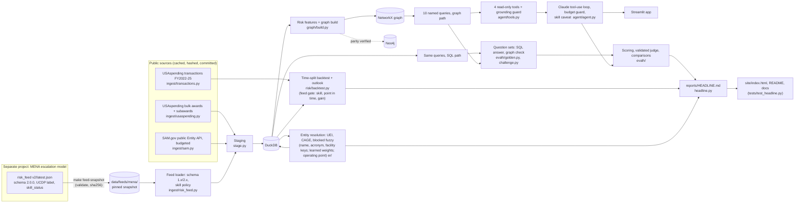
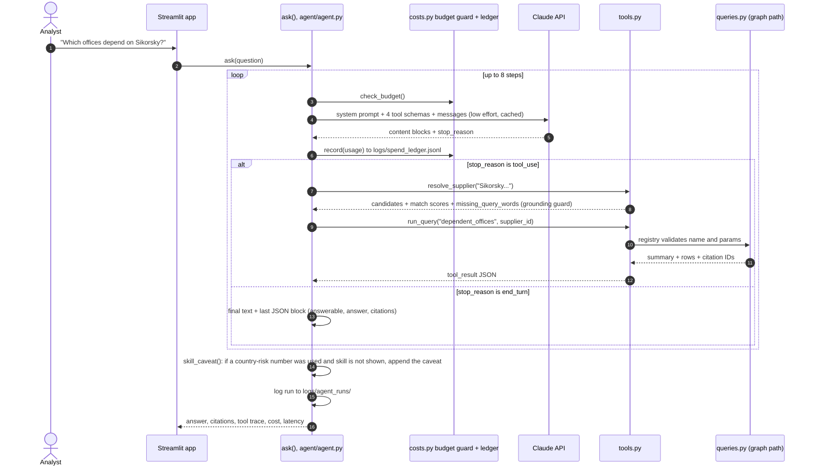

# Interview walkthrough: defense supplier-risk graph

> Portfolio project on public data. The customer persona is fictional. This project is not used by, endorsed by,
> or built for the DoD or any company. Say that sentence early in any interview.

**How to use this file.** Regenerated on 2026-11-19 from the final state of the repo; it replaces every earlier
version. Read sections 1, 3.5 and 8 first. Answers are written to be said out loud, in first person, and each takes
under 60 seconds unless marked **[deep dive]**. Every headline number here is in `reports/HEADLINE.md` (written by
`make headline` from the result JSONs), and `tests/test_headline.py` fails if this file disagrees with it. Numbers
marked *computed for this walkthrough* come from the committed reports or the local DuckDB file but are not
headline numbers.

**Pushback flags.** Paragraphs marked **⚠ Pushback risk** are where an interviewer who digs will find something weak.
Each says what is weak and what to study.

### The honesty point to settle first

Every commit carries a `Co-Authored-By: Claude Opus 5.5` trailer. An AI coding agent wrote nearly all the code,
working from your written plans (kept in your private working repo, not the public one). A technical interviewer who opens
the repo will see this. Say it plainly and early, then show you own the work by defending decisions and naming
weaknesses yourself:

> "I wrote the plan: the customer framing, the scope, and the hard rules, like no hand labels, a $10 model budget,
> every eval answer checked two independent ways, and every number reproducible from a make target. Then I had
> Claude Code implement it. My job since has been auditing it: re-deriving numbers, reading the code, and finding
> where the evaluation is weaker than the headline. I can walk you through any file and tell you what I'd change."

Only claim a finding as yours once you've checked it in the code yourself.

---

## 0. What changed in the final session

* **Country-risk feed v2, gated by evidence, not by its label.** The MENA project shipped schema 2.0.0: `p_escalation`
  now forecasts a different event (schema 2.0.0, label escalated_next4w_ucdp, instead of an ACLED-defined escalation)
  and reports `skill_status = beats_base_rate`. I switched to it, rebuilt everything and re-asked the 8 questions
  whose expected answers changed; every score held. A pre-registered backtest gate decides whether any feed input
  enters the termination-likelihood model: skill, point-in-time coverage, then a measured improvement. Result:
  `p_escalation` was not adopted: 0% point-in-time coverage, because the feed has no forecasts for the backtest's
  years. Feed-country exposure was testable but didn't help (AP -0.0004 [-0.0073, 0.0071]). So country risk stays
  context, and the app, site and agent answers say why.
* **ER operating point.** A stricter threshold and runner-up margin, chosen on half the held-out records and
  confirmed on the other half, cut absent-company false links 8.7% → 4.4%.
* **Opus variance where it matters.** The near-miss traps were re-run twice for Opus: 7/8, 7/8, 7/8. A full repeat
  would have broken the $10 cap.
* **One source of truth.** `reports/HEADLINE.md`, enforced by a test against the README, final report, site, brief,
  demo script and this file.
* **Clean clone works offline.** Cached public data is committed; `make install && make offline` rebuilds every
  report identically with no network and no API key (checked in a fresh clone).
* **Air-gap readiness.** The app's graph view no longer pulls JavaScript from a CDN, and Streamlit telemetry is off.

---

## 1. Pitches

### 30 seconds

"I built a supplier-risk knowledge graph from public Defense Department contract data, for a fictional sustainment
analyst who needs to know which maintenance contracts depend on concentrated, sole-sourced or overseas suppliers,
and what breaks if one fails. It covers 57,596 contracts worth $225.2B and 11,658 resolved suppliers, with a Claude
agent that cites a record ID for every fact. The interesting part is what testing taught me. My risk flags measure
impact, not likelihood: as a predictor of next-year terminations they score 0.635, below just counting contracts at
0.758. The agent's real failure wasn't reasoning, it was look-alike company names, which I fixed in the tool. And my
entity matcher scored above 0.9 on pairs but resolved only 55.8% of renamed companies end to end, until I fixed the
blocking."

Sources: `reports/HEADLINE.md`.

### 2 minutes

> "The customer is a fictional sustainment analyst: which contracts depend on concentrated, sole-sourced or exposed
> suppliers, and what breaks if one fails?
>
> I pulled every DoD maintenance contract and subcontract from USAspending for three years, cached and hashed so
> every number traces to a source, and resolved 11,658 suppliers. Resolution is where the first lesson was. My
> matcher scored above 0.9 on labelled pairs, but when I withheld identifiers and resolved renamed companies end to
> end, it got only 55.8% right. The losses were acquisitions at the same facility, which my blocking never
> compared. Facility-address blocking plus learned evidence weights took that to 82.7%, and a stricter operating
> point, chosen on half the records and confirmed on the other half, cut false merges of absent companies from 8.7%
> → 4.4%.
>
> The graph links suppliers, parents, awards, offices and countries, and I checked it twice: every query in graph
> and SQL, and the whole graph against Neo4j.
>
> Then I tested my own risk flags against next year's contract terminations. They don't predict them: 0.635 against
> 0.758 for contract count. Concentration looks three times riskier until you control for size, and sole-source
> suppliers are the most stable. So the flags measure impact, and the product shows likelihood on its own axis.
>
> The agent is Claude with four read-only tools; it cites record IDs or declines. My first test set saturated, so I
> built a harder one with traps. Even the small model answers every structured question. Its failure was a company
> name one word off, which it answered for the look-alike. I fixed that in the name lookup, not the prompt, and the
> small model went from 1/8, 3/8, 3/8 to 7/8, 8/8, 7/8 on those traps. Everything is a pytest gate, and the whole
> project cost $9.00 in API calls."

### 5 minutes [deep dive]

Use the 2-minute version and add these beats, about 45 seconds each.

1. **How I tested my own screens.** "Concentrated is at least 25% of an office's obligations; sole-source is at
   least 50% non-competed; geo-exposed is at least 25% foreign or any work in a risk-feed country. 86.75% of dollars
   go to a flagged supplier, so I asked whether the flags predict anything. Outcome: any termination or cancellation
   next fiscal year, from transaction action codes. Time split: train FY2022-23, test FY2024 features against FY2025
   outcomes, 5,541 supplier-years with 145 events. Flags 0.635, contract count 0.758, my model 0.772. The model's
   AUC gain over size is +0.013 [-0.013, 0.039], not significant, but average precision gains +0.070 [0.028, 0.110],
   so it's better at the top of the list. Size-adjusted, concentration goes 3.06 → 0.77, sole-source is protective at
   0.66 [0.52, 0.82], and geography goes 1.75 → 1.00 once you remove one Navy office in Japan."
2. **Why named queries instead of text-to-SQL.** "Ten parameterized queries and nothing else: read-only by
   construction, reproducible, testable. The payoff showed in the comparison: with these tools even Haiku answers
   38/38, 38/38, 38/38 structured challenge questions, at 1/49 of Opus's cost per question."
3. **How the eval works and what it doesn't prove.** "Expected answers come from SQL and are re-derived by graph
   traversal. The harder set has traps, including names one word off a real supplier. A check in the resolver lists
   query words the matched name lacks; it fires on 0 of 88 logged Opus lookups on answerable questions, so it can't
   hurt those. The judge grades prose only and was validated on 40/40 blatant and 30/30 subtle planted errors. It's
   still template traffic, not real analyst questions."
4. **What I'd do next.** "Sit with the analyst to see which decisions the two-axis view changes. Add past
   performance and financial data so the backtest predicts supplier fault, not terminations for convenience. Replace
   templates with real questions, keeping the dual-path answer check."

---

## 2. Architecture diagrams

SVG exports of earlier versions are in `docs/diagrams/`; the Mermaid below is current and renders on GitHub.

### 2a. Whole system

How it connects to the other project: the MENA project publishes a versioned weekly feed of `p_escalation` per
country. This repo copies a validated snapshot into `data/feeds/mena/` (`make feed-snapshot`) and stages from the
snapshot, so a clean clone reproduces every number. The current snapshot is schema 2.0.0: 14 countries, 168 rows,
weeks 2026-08-24 to 2026-11-09, model `6268b40`, calibration `platt_logodds`, label `escalated_next4w_ucdp`
(*computed for this walkthrough*). The snapshot replaced v1 rather than extending it: the producer says not to join
v1 and v2 probabilities, because they forecast different events. The two repos share a data contract (the producer's
`SCHEMA.md` and migration note), not code.

### 2b. Most complex flow: one agent request, from question to cited answer

Key places: loop `src/supplier_graph/agent/agent.py:148` (`ask`), budget check line 158, API call line 162, tool
dispatch line 186, caveat `agent.py:129` (`skill_caveat`), guard `src/supplier_graph/agent/tools.py:37`
(`missing_words`), query registry `src/supplier_graph/graph/queries.py:633`.

---

## 3. Mock interview transcript

*Interviewer: a senior data scientist at a defense software company, hiring a forward deployed data scientist.*

### 3.1 Problem framing

**Q: Who is the user, and what decision does this support?**

"A sustainment analyst in a program office, a fictional persona. They buy maintenance, repair and overhaul to keep
equipment running. The decision is triage: which suppliers deserve a closer look, and if one goes away, which
contracts, offices and programs are hit? It's not a failure predictor. I tested whether my flags predict
disruption and they don't, so the product shows impact and likelihood as two separate things, each with an honest
label."

> **Follow-up: How would you know it worked for that analyst?**
>
> "Three levels. Correctness, which I measured: answers match the data and citations are real. Time saved: a
> question that took an afternoon of joins takes a minute and is trusted enough to go in a brief. Decisions: did a
> flag lead to market research or a second-source effort? I can only measure the first in a portfolio project. With
> a customer I'd log which answers get opened and cited, and have them mark a sample right or wrong every week."

> **Follow-up: Why those three risk dimensions?**
>
> "They're what public contract data can show. Concentration from obligations by office, sole-source from the
> extent-competed field, geography from place of performance. Financial health or single-source parts need data I
> don't have. I kept them as transparent thresholds an analyst can argue with."

### 3.2 Pipeline, stage by stage

**Q: Walk me through ingestion.**

"Two bulk jobs against USAspending: awards plus subawards for DoD, contract types A to D, product codes starting
with J, FY2023-FY2025; and contract transactions FY2022-FY2025 for the backtest, 187,320 rows. I verified endpoints
and fields with small probes first; for example the transactions endpoint ignores one documented filter and needs
`award_type_codes` passed directly. Each response is converted to parquet and saved with the request body, pull
time, row counts and SHA-256, keyed by a hash of the request, so re-running makes no network call. That cache is
committed now, so a fresh clone rebuilds offline." (`src/supplier_graph/ingest/usaspending.py`,
`ingest/transactions.py`, `docs/design_doc.md` section 2.)

**Q: What happens in staging?**

"Everything lands in DuckDB, where I fix the quirks: subaward country codes mix ISO-2 and ISO-3, program code '000'
means none, sole-source is extent-competed B, C, G or NDO, and every duplicate gets an explicit, deterministic
tie-break. The country-risk feed is staged from a pinned snapshot with its skill status."

> **Follow-up: Why DuckDB and not Postgres?** "About 93,000 award and subaward rows. DuckDB runs in-process, needs
> no service, and keeps the repo self-contained. With concurrent users I'd move to Postgres or the customer's
> warehouse."

**Q: [deep dive] Entity resolution. How does it work, and how do you know it's any good?**

"Exact UEI first, then CAGE if it maps to exactly one UEI, then blocked fuzzy matching. Blocking keys are name
tokens, acronyms, and a facility key: normalized street address plus ZIP. Scoring is a logistic regression on
agreement evidence (name similarity, acronym, address, ZIP, city, state, country, with missing-value indicators),
the supervised cousin of Fellegi-Sunter. It beat my hand-set weights on dev F1.

Labels are automatic: positives share a UEI but are written differently; hard negatives are similar names with
different UEIs and parents; synthetic pairs are real records perturbed with typos, abbreviations, suffixes,
acronyms and dropped words. The matcher's input type has no identifier fields, so it can't cheat. Split by UEI hash,
tuned on dev, reported on test: P 0.949 / R 0.909 on identifier pairs, P 0.954 / R 1.000 on synthetic pairs, and
acronym recall 0.10 → 1.00.

Then the important part: pairwise scores don't tell you what happens when a record arrives with no UEI and must be
found among 11,158 suppliers. I took 620 real records whose name differs from their company's main record, hid the
UEI, and resolved them end to end. The original matcher got 55.8% right. Most losses were renamed or acquired
companies at the same facility, which name blocking never compared. With the facility key and learned weights:
82.7%, wrong links down from 5.32% to 3.55%."
(`src/supplier_graph/er/`, `reports/entity_resolution.md`, `reports/er_holdout.json`.)

> **Follow-up: Absent-company false links went up from 7.0% to 8.4%. What did you do about it?**
>
> "That was the price of facility blocking: a company that isn't in the index can now be matched to a different
> registration at the same address. I searched 140 operating points: the threshold, the runner-up margin, and a
> stricter threshold for candidates found only through the address. I fixed the rule before looking: correct-link
> rate minus two times the false-merge rates, because a false merge silently corrupts two companies while a miss
> leaves a visible unresolved record. Chosen on a hash-split tuning half, reported on the other half: threshold 0.70,
> margin 0.20. On the confirmation half, absent false links 8.7% → 4.4%, wrong links 3.8% → 0.6%, correct links
> 83.6% → 78.5%. The address-only rule never won; a clearer winner did. Weights of 1 or 3 pick the same threshold."

> **Follow-up: Did fuzzy matching matter in production?**
>
> "Not for the batch: every award and subaward here carries a UEI. It matters for the agent's name lookup and for
> customer data without UEIs, like an ERP vendor table. That's why I measured it end to end."

> **⚠ Pushback risk: the facility key was added after diagnosing the evaluation records.** It has no tunable
> parameter and the weights come only from dev pair labels, but the before/after is measured on the records that
> motivated it. Say so. The later operating-point choice is clean: tuning half and confirmation half.

> **⚠ Pushback risk: learned weights inherit label artifacts.** "State missing" gets a positive weight, which
> reflects how the automatic labels were built, not reality.

**Q: Tell me about the graph and the risk features.**

"Six node labels (Supplier, ParentCompany, Award, Office, Country, ProductServiceCode) and six edge types
(AWARDED_TO, SUBCONTRACTS_TO, SUBSIDIARY_OF, PERFORMED_IN, AWARDED_BY, CATEGORIZED_AS), with provenance on every
node and edge. Served from NetworkX, verified against Neo4j: equal counts for every label and type, and a Cypher
two-hop blast radius equal to NetworkX for 30/30 sampled suppliers. Risk features come from one SQL script: office
concentration, sole-source share, dependent offices, PageRank, foreign share and feed-country exposure. 4,312
suppliers carry at least one flag." (`src/supplier_graph/graph/build.py`, `reports/neo4j_parity.json`.)

**Q: The query library: why two implementations of everything?**

"Each of the ten named queries has a graph version, which serves the agent, and an independent SQL version, which
verifies. Tests require exact agreement. That lets every expected answer in the question sets be computed two ways;
disagreements are dropped and logged, and none were."

> **⚠ Pushback risk: independent at the query layer only.** Both paths read the same staged tables, so dual-path
> agreement verifies traversal and aggregation, not upstream definitions or entity resolution. A data-layer check
> would compare against USAspending's own totals for a sample of suppliers.

**Q: [deep dive] Walk me through the agent.**

"A manual tool-use loop on the Messages API. The client is constructed with no arguments, so credentials come from
the environment. Claude Opus 5.5, low effort, prompt caching, at most eight steps. Four tools: `resolve_supplier`,
`run_query` (the query name is an enum, so it can't invent one), `country_risk`, and `award_details`. Tool
exceptions go back to the model as errors. The system prompt says cite IDs inline, only IDs that came back from
tools, say so when the data can't answer, and end with a JSON block: answerable, answer, citations. That JSON is
what I score. A budget guard checks the spend ledger before every call.

Two deterministic safeguards sit outside the model. The resolver's grounding guard lists query words the matched
name lacks and says not to substitute silently. And if an answer used an escalation probability while the feed's
skill isn't demonstrated, the application appends the caveat itself, so it never depends on the model remembering."

> **Follow-up: Why a manual loop instead of a framework?** "Every step visible for logging and cost accounting,
> thinking blocks passed back unchanged, and it's short. A framework would hide what I'm measuring."

> **⚠ Pushback risk: cost is an estimate.** Usage times a price table, not reconciled with the billing console, and
> the guard is a soft check with three parallel workers. Say "logged cost of $9.00."

### 3.3 Data

**Q: What are the data's quirks, and what did you do about them?**

"Country codes normalized; program code '000' is null; negative obligations floored at zero for shares; 686
subawards point to prime awards outside the window and are dropped and counted. Obligations are lifetime totals on
awards active in the window. Subcontract reporting is thin: only 3.8% of in-scope prime awards report any subaward,
so indirect dependencies are a floor. Program codes appear on 2,201 awards, about 20% of obligations, and 3,907
awards lack a place of performance. `make graph` writes all of these into `reports/graph_summary.json`."

**Q: Tell me about the country-risk feed.**

"It comes from my separate MENA escalation project: weekly probabilities for 14 countries. The latest version is
schema 2.0.0, label escalated_next4w_ucdp: it switched from an ACLED-defined escalation to a UCDP-defined one,
because ACLED's new license bars training models on its data. The two labels only moderately agree, so this is a new
meaning, not a refresh. My loader accepted 2.x in advance but reported the new folder rather than following it; I
switched deliberately, rebuilt, and re-asked the 8 questions whose answers changed.

Its own evaluation now says `beats_base_rate`: better than a regional average, not better than each country's own
history. I treat skill as necessary, not sufficient. Every place a probability appears says what it is and how the
tool uses it."

**Q: The feed beats the base rate now. Why isn't it in your likelihood model?**

"Because my own test couldn't show it helps, and I wrote the rule down before running it. A feed input gets in only
if three things hold: the feed claims skill; there's a point-in-time value for the years I'm testing, meaning a
forecast that was available by the end of that fiscal year; and adding it improves the current model on held-out data,
with the average-precision gain's confidence interval above zero. The v2 feed starts in August 2026. My backtest's
feature years are FY2022 to FY2024. So for `p_escalation` the answer is not adopted: 0% point-in-time coverage. I
could have joined today's forecasts onto 2023 supplier-years, and it might even have looked good, but that's
leakage: using the future to predict the past. The one feed-derived input I could test, whether a supplier works in
a feed country at all, didn't help: AP -0.0004 [-0.0073, 0.0071]. So the model and every backtest number are unchanged,
and the gate re-runs automatically when the producer publishes forecasts covering those years."

> **Follow-up: Then why show the probability at all?** "Because the analyst still wants to know where a supplier
> works and how volatile that place is right now. That's impact context: it changes how bad a disruption would be
> to recover from, not how likely a termination is."

**Q: How did you handle SAM.gov?**

"Personal keys can be limited to about 10 calls a day, at 10 UEIs per call, so I budgeted it, cached every call
and enriched the 67 largest subawardees through the public API; every record is public-display. Resolution doesn't
depend on it. Finishing enrichment is an optional daily `make sam`."

### 3.4 Evaluation, in depth

**Q: What's your baseline?**

"Several. For the risk flags: contract count, prior-year terminations and the untrained flags, and the flags lose to
contract count. For entity resolution: the original hand-set matcher, end to end. For the agent: Opus with no tools,
which answers 0/38 on the challenge set because it declines rather than invents; and Haiku with the same tools,
which matches Opus on structured questions at 1/49 of the cost but fails look-alike names until the guard."

**Q: What are the agent results?**

"v1 set, 101 questions: Opus 87/88 answerable and 13/13 correct refusals, 0 fabricated IDs out of 614 cited, mean 2.4
steps, about 3 cents and 7 seconds a question. Haiku scored 83/88, 83/88, 83/88 in three runs; with the guard
82/88, 83/88, 83/88. Harder challenge set, 38 answerable plus 14 traps: Opus 38/38 and 13/14 at $0.041 a question.
Haiku 38/38, 38/38, 38/38 but traps 7/14, 9/14, 9/14. With the guard, traps 13/14, 14/14, 13/14. On the eight
near-miss traps specifically: Haiku 1/8, 3/8, 3/8; Haiku with the guard 7/8, 8/8, 7/8; Opus 7/8, 7/8, 7/8."
(`reports/comparison.md`, `reports/eval_report.md`.)

> **⚠ Pushback risk: Haiku's citations.** In one v1 run each, Haiku cited real supplier IDs under the wrong prefix
> (`parent:` instead of `supplier:`): 0, 0, 3 (guard: 0, 0, 4) per run. The scorer counts them as fabricated because
> no ParentCompany has that ID. They're mislabelled, not invented, but say "Opus had zero; Haiku mis-typed a few."

**Q: Isn't revising the challenge set after a pilot tuning to the test?**

"It would be if I'd changed the agent. The first draft saturated: Haiku scored 44/44, 44/44, 44/44. I changed only
the test, to make it discriminate, with the prompt and tools frozen. The draft and its results are committed and
disclosed. The guard came afterwards as a tool change, measured against the unguarded runs."

**Q: How do you prevent leakage?**

"For ER, the matcher can't see identifiers (tested), and the split is by UEI hash. For the agent, questions are
generated from data and answers come from code the agent can't call. The subtler leakage is design informed by
results: the hard tier, the accepted alternative queries, the challenge revision and the facility key. Each is
disclosed with before and after numbers."

> **⚠ Pushback risk: post-hoc metric change.** Accepted alternative queries were added after the first run because
> three correct hard-tier answers scored as wrong trajectories. Tool-call correctness would have been 94/98 before
> instead of 97/98. Disclose it if asked.

**Q: Confidence intervals and variance?**

"Wilson intervals are in the comparison report. 87/88 is about 93.8% to 99.8%, and 13/13 is 77% to 100% because 13
is small. They're optimistic: questions from one template are correlated. Haiku ran every set three times. Opus ran
the full sets once, because one challenge run costs about $2.14 and two more would break the $10 cap; I spent the
remaining budget re-running Opus on the eight near-miss traps, where variance matters for the guard comparison: 7/8,
7/8, 7/8."

**Q: What does "zero fabricated IDs" actually mean?**

"Every cited ID exists in the graph and appeared in that run's tool input or output: 614 of 614 for Opus on v1. It
doesn't mean each citation supports the sentence it's attached to. A claim-level checker would look up the record
and compare it to the sentence. That's open work."

**Q: How do you know the judge is trustworthy?**

"I validated it before using it, and only for prose quality; correctness is scored by code. It agreed with known
labels on 40/40 blatant corruptions and 30/30 subtle ones planted in real agent prose: counts off by one, shares
moved five points. Limits: it's the same model family as the agent, so self-preference is possible."

### 3.5 The five questions you will get

**Q: "Your risk flags don't predict terminations. So what's the product worth?"**

"Three things, and the backtest is part of the value, not a problem for it. First, the product's job is impact:
what depends on a supplier. The blast radius, the dependent offices and the subcontract links are what an analyst
needs when a supplier is in trouble for any reason, and none of that is a prediction. Second, the backtest stops
the analyst acting on a false signal. Before it, 'concentrated' looked three times riskier; after controlling for
size it's 3.06 → 0.77, and sole-source suppliers are the most stable at 0.66 [0.52, 0.82]. A tool that ranked
suppliers by flag count would have pointed people at the wrong places. Third, likelihood now has its own tested
score. The model only matches contract count overall, but it's clearly better at the top of the list, average
precision +0.070 [0.028, 0.110], and it highlights 36 suppliers with at least $10M at stake that are twice as likely
as their size predicts. So the honest pitch is: here's what breaks if this supplier fails, and here's a separately
validated short list to look at first."

> **Follow-up: Isn't termination for convenience a bad proxy?** "Yes, and I say so first. It's disruption from the
> buying office's side, not supplier fault, and one Navy office in Japan is 17%-38% of each year's events. The
> finding I'd defend is the negative one, which holds with and without that office."

**Q: "How do you know the agent isn't making things up?"**

"Five layers. One: it can't compute numbers itself. Every number comes from a named query that I also implemented
in SQL and checked for exact agreement. Two: every expected answer in the test sets was computed two ways, and the
scoring is deterministic code. Opus got 87/88 and 38/38. Three: citations are checked. Every cited ID must exist
and must have appeared in that run's tool output, and Opus had 0 fabricated. Four: it's tested on questions it
should refuse: 13/13 unanswerable on v1, 13/14 traps on the harder set. Without tools it answers 0/38 rather than
invent, so the model's default is to decline. Five: the failure I did find, look-alike names, I fixed in the tool,
and the guard fires on 0 of 88 Opus lookups on answerable questions, so it can't break them. What I can't yet show
is claim-level support for every sentence; that's the next check I'd build."

**Q: "Why a graph instead of SQL?"**

"Honestly, every query also exists in SQL, and the SQL path is my verification path. The graph earns its place in
three ways. Dependency questions are multi-hop by nature: subcontractor to prime award to office to program, and
with deeper subcontract tiers the hop count isn't fixed, which is awkward in SQL and natural as a traversal. The
schema is how analysts think: who depends on whom. And it's the shape a graph database and a graph UI expect; I
checked Neo4j gives identical answers, 30/30 on the blast radius. If the questions were all flat aggregates, I'd
use SQL views and skip the graph."

**Q: "How would you deploy this inside a customer's network with no internet access?"**

"Most of it already runs offline, because I tested a fresh clone with outbound traffic blocked and no API key:
`make offline` rebuilt every report identically. For an air-gapped network:
- **Code and dependencies:** bring them across through the customer's transfer process as a reviewed bundle:
  pinned wheels for the Python packages, container images for the app and Neo4j, plus SHA-256 checksums.
- **Data:** replace the USAspending pulls with their own exports (contract-writing system, FPDS extracts, vendor
  master). The cache-and-manifest pattern is already there: every input carries its request, time and SHA-256.
- **The model:** the agent needs an approved model endpoint inside that network. The client takes no arguments
  and reads credentials and endpoint from the environment, so pointing it at an accredited endpoint is
  configuration, not code. If only a different model is approved, the eval harness tells you exactly what you
  lose on these questions before anyone relies on it.
- **The app:** I removed the last outbound calls: the graph view now inlines its JavaScript instead of loading it
  from a CDN, and Streamlit usage statistics are off. Everything else is local.
- **What still doesn't work without a model:** the chat tab. The graph explorer, risk table, likelihood view and
  results site work with no model at all."

> **Follow-up: What about classification and access control?** "Their data may be CUI or higher, so it runs inside
> their accredited enclave with their identity system. The read-only tool design helps: the model can't write
> queries, so access control lives in the named queries and the database permissions."

**Q: "What would you do differently with real program-office data?"**

"Five things. First, entity resolution becomes central: their vendor tables won't carry UEIs, so I'd run the
end-to-end test on their data and set the operating point with them, since how much a false merge costs versus a
miss is their call. Second, part-level data: bills of material and national stock numbers, because contract data
shows who you pay, not what they make; that's where real single points of failure are. Third, better outcome
labels: past-performance ratings, delivery delinquencies and supplier-fault terminations, so the backtest predicts
fault, not convenience terminations. Fourth, their questions: I'd collect the ten they actually ask, add them as
templates, and keep the two-way answer check. Fifth, their thresholds: what counts as concentrated is a judgment I'd
set with the analyst, with a sensitivity table showing how many suppliers flip."

### 3.6 Mistakes I found and fixed

*Story 1: nondeterminism (lead with it).* "Two identical runs gave different ER thresholds. I traced it to DuckDB
aggregates like `mode()` and `any_value()` picking arbitrarily among ties, plus unordered iteration. I replaced each
with an explicit ordered tie-break and confirmed with identical table hashes across runs. Now a fresh clone
reproduces every report apart from timestamps. If a number isn't reproducible, it isn't a result."

*Story 2: the build that couldn't run.* "In the second session `make er` failed on the committed code: a CTE dropped
the record ID the tie-break needed, so the committed tables came from an earlier version. After the fix, parent
companies went to 9,096, and I re-ran the questions whose answers changed."

*Story 3: pairwise metrics that hid the real gap.* "Above 0.9 on pairs, 55.8% end to end. Diagnosing the misses
showed blocking, not scoring, was the problem."

*Story 4: a nondeterministic program name.* "The SQL path took a program's name from an unordered first row, so a
program code with two names could make SQL and graph disagree. Fixed with a minimum over rows and a regression test."

*Story 5: an unstated number.* "Building the headline file, I found Haiku's runs had a few mis-prefixed citations the
earlier summaries never mentioned. They're in the headline now. That's why every number lives in one generated file."

### 3.7 Limitations

**Q: What can't this do?**

"It can't predict failure; the public outcome is terminations, mostly for convenience. It can't answer questions
outside the ten named queries; it says so. It only sees subcontracts primes report, 3.8% of awards. Program
attribution is sparse. The country-risk feed hasn't demonstrated skill, so it's context only. Name grounding is
improved, not solved: the guard warns the model, it doesn't block it. The question sets are small and templated,
and Opus's full-set variance is unmeasured."

### 3.8 Skeptical questions

**Q: Isn't this just a SQL dashboard with a chatbot on top?**

"In one sense, deliberately. The value is underneath: entity resolution so 'Sikorsky' means every Sikorsky record,
provenance so every number traces to an award ID, and an evaluation that says when the chat layer is wrong. The
model routes questions and explains results with citations; it never computes numbers."

**Q: Why should anyone trust this?**

"Don't trust it, check it. Every claim has an ID that links to the USAspending record, every number comes from a
named query you can re-run, and the reports state their own failures. Where I'd not trust it: the country-risk layer
and any ranking implied by the flags."

**Q: What would break in production?**

"Concurrency: an in-memory graph and single-writer DuckDB, so multi-user serving needs Neo4j or a real database.
Refresh: no scheduler; a data refresh means a pull, a rebuild, regenerating the questions and re-asking the changed
ones, which the runbook scripts. Cost control: the budget guard is a soft local check. And model changes, which is
why the live eval sample should gate every change."

**Q: Why not text-to-SQL?**

"Harder to keep read-only and harder to evaluate, because every answer is a new query. Named queries let me test
every path. If customers kept asking things outside the ten, I'd add queries or move to text-to-SQL behind the
same eval."

**Q: How much of this did you write?** See "The honesty point to settle first."

### 3.9 Why this matters to a defense software company

"Readiness depends on the industrial base, and these are the questions: who do we depend on, how concentrated, what's
overseas, what breaks. The hard parts are the forward deployed parts: messy identity across systems, turning a
vague question into something measurable, testing your own assumptions against outcomes, and making an AI
assistant trustworthy enough that an analyst puts its answer in a brief. I treated it like an engagement:
requirements with acceptance criteria, a blockers log, a one-page brief and a demo script."

---

## 4. Code tour

Line numbers as of this regeneration.

### 4.1 The agent loop: `src/supplier_graph/agent/agent.py:148` (`ask`)
Builds the message list and loops up to `MAX_STEPS = 8` (line 27). Each iteration checks the budget (line 158),
calls `client.beta.messages.create` (line 162), records cost, appends the assistant content unchanged (thinking
blocks survive), and runs requested tools (line 186), returning errors to the model instead of crashing. After the
loop, `skill_caveat` (line 129) attaches the feed caveat when needed and `parse_final_json` (line 102) takes the last
JSON block. The client is `anthropic.Anthropic()` with no arguments (line 144).
*Be ready for:* "What if the model never stops?" It stops at 8 steps and records an error.

### 4.2 Name resolution and the guard: `src/supplier_graph/agent/tools.py:90` (`resolve_supplier`), `:37` (`missing_words`)
Exact UEI is a hit; otherwise the top fuzzy candidates are re-scored by `name_score` (line 80), which only credits
token-set similarity when most query words are covered. Acronym candidates come from an initials index. With the
guard on (`GUARD`, line 24, default on), the result lists query words the matched name lacks, ignoring legal suffixes
and canonical abbreviations, and sets `exact_name_match: False`.
*Be ready for:* "Why not just raise the threshold?" A look-alike can score high on similarity; the missing word is
the signal.

### 4.3 Blast radius, both paths: `src/supplier_graph/graph/queries.py:147` and `:441`
Graph: the supplier's prime awards are the direct set; awards it subcontracts on, minus those, are the indirect set;
then group by office, collect programs and prime customers. SQL: one CTE builds the same set with `UNION` and
`NOT IN`. The registry at line 633 validates names and parameters.

### 4.4 Learned evidence linkage: `src/supplier_graph/er/matcher.py:100` (`evidence`), `src/supplier_graph/er/linkage.py:35` (`fit`)
`evidence()` returns agreement features with missing indicators; `fit()` is a logistic regression on dev pairs;
`load_scorer()` (line 47) returns the probability function and dev-tuned threshold. `is_acronym_of` (matcher line 68)
handles "QRC" vs "Quality Refrigeration Corp".

### 4.5 Blocking, decision rule and operating point: `src/supplier_graph/er/resolve.py:76` (`candidate_scores`), `:99` (`decide`); `src/supplier_graph/er/holdout.py:130` (`tradeoff`)
`candidate_scores` collects candidates from name, acronym and facility keys (`_addr_keys`, line 65) and remembers
whether each came only through the address. `decide` applies threshold, margin and the address-only rule.
`tradeoff` runs the 140-point grid on the tuning half with `FALSE_MERGE_WEIGHT = 2.0` (line 36) and reports the
confirmation half.

### 4.6 The backtest and the feed gate: `src/supplier_graph/risk/backtest.py:95` (`supplier_years`), `:266` (`feed_gate`), `:303` (`evaluate_split`)
Supplier-year features from year-t transactions only; outcome is an event in t+1. `supplier_years` also builds the
point-in-time `feed_p_escalation` (only feed rows with `data_cutoff` by 30 Sep of FY t, at most 26 weeks old).
`FEED_FEATURES` (line 70) carries the adoption rule as a comment; `feed_gate` applies it with its own RNG stream, so
the main bootstrap draws don't change whether it runs. `likelihood_features` (line 81) adds only adopted inputs.
`size_adjusted_flag_effects` (line 350) gives the odds ratios; `outlook` (line 373) writes the two-axis table.

### 4.7 Feed loader and skill policy: `src/supplier_graph/ingest/risk_feed.py:148` (`validate`), `:91` (`likelihood_allowed`), `:241` (`feed_in_likelihood`)
Schema majors 1 and 2, `skill_status` required from 1.1, `label` carried through, constant within a file; sha256
checked; newer major folders reported as notices; `snapshot` (line 256) pins the feed in the repo with the right
attribution (UCDP for v2). `feed_in_likelihood` reads the backtest's decision, so the app and agent text follow it.

### 4.8 Golden set and scoring: `src/supplier_graph/evalh/golden.py:71` (`both`), `src/supplier_graph/evalh/metrics.py:47`, `:97`, `:112`
`both()` runs a query on both backends and drops the item if they differ. `answer_correct` compares by type;
`citation_metrics` checks existence and grounding in the tool I/O; `tool_call_correct` accepts the expected query or
a declared alternative.

### 4.9 One source of truth: `src/supplier_graph/headline.py`, `tests/test_headline.py`
`build()` reads the result JSONs into 62 named strings; the test checks the file is current, that each document
quotes its numbers, and that no stale fractions, AUCs, spend or ER rates appear.

---

## 5. Explaining it to a non-technical stakeholder (under 90 seconds)

"The military spends billions keeping its equipment running, and much of that depends on a small number of
companies. Some win work without competition, some work overseas, and some are the only supplier an office really
uses. If one has a problem, what else gets hit?

I built a tool that answers that from public contract records: three years of Defense Department maintenance
contracts, about 57,600 of them worth $225 billion. It works out which records belong to the same company and maps
who depends on whom. You can ask it a question in plain English, and it answers with a reference number for every
fact, or says the data can't answer.

The surprising part: I checked whether my own warning flags predicted which suppliers would have contracts ended
early the next year, and they didn't. They tell you how much depends on a supplier, not how likely trouble is. So the
tool shows those two things separately, and I can tell you exactly how far to trust each."

---

## 6. Glossary

| Term | Plain definition (with this project's numbers) |
|---|---|
| **Entity resolution (ER)** | Deciding which records are the same company. 57,596 awards and 35,842 subawards resolved to 11,658 suppliers and 9,096 parents, paid by 757 offices. |
| **Blocking** | Cheap keys that decide which record pairs get compared at all. Missed blocks are invisible to pairwise metrics; that's what the end-to-end test caught. |
| **Facility key** | Blocking on normalized street address plus ZIP5, for renamed or acquired companies at the same site. |
| **Evidence linkage** | Combining agreement evidence with learned log-odds weights; the supervised counterpart of Fellegi-Sunter. |
| **Operating point** | The threshold and margin the matcher uses: threshold 0.70, margin 0.20, chosen on the tuning half. |
| **Absent-company false link** | Linking a record whose company isn't in the index at all: a false merge. |
| **UEI / CAGE** | The federal unique entity ID and the older facility code. Trusted before fuzzy matching. |
| **PSC J** | Product and Service Code category for maintenance, repair and rebuilding of equipment, the scope. |
| **Sole-source** | Not competed: extent-competed codes B, C, G and NDO. |
| **Subaward** | A subcontract a prime reports publicly; only 3.8% of in-scope prime awards have any. |
| **Knowledge / property graph** | Typed nodes and edges with properties; good for multi-hop "who depends on whom." |
| **Provenance** | Where a fact came from: source, pull time and request key on every node and edge. |
| **Blast radius** | Hop 1: awards a supplier holds or subcontracts on. Hop 2: offices, programs and primes on those awards. |
| **Backtest (time split)** | Fit on earlier years, test on a later one, so no future information leaks in. 5,541 test supplier-years, 145 events. |
| **ROC-AUC** | Chance a random positive ranks above a random negative; 0.5 is a coin flip. Flags 0.635, contract count 0.758, model 0.772. |
| **Average precision** | Rewards putting true positives at the top of a ranking; the model's gain over size is +0.070 [0.028, 0.110]. |
| **Odds ratio (size-adjusted)** | How much more often flagged suppliers have an event than unflagged ones of similar size. 1 means no difference. |
| **Skill status** | The MENA feed's own verdict on whether its model beats simple baselines. Currently `beats_base_rate`: better than a regional average, not than each country's history. |
| **Point in time** | Using only data that was available at the moment being simulated. A 2026 forecast attached to a 2023 supplier-year would leak the future. |
| **p_escalation** | The feed's weekly probability that a country escalates; shown as context only here. |
| **Named / parameterized query** | A fixed query where only parameters vary. The agent can't write its own. |
| **Dual-path verification** | Computing each expected answer in SQL and in the graph and dropping disagreements. |
| **Grounding guard** | The resolver's list of query words the matched name lacks, so the model doesn't silently swap companies. |
| **Near-miss trap** | A question naming a real supplier with one distinctive word changed; the right answer is to decline. |
| **Fabricated citation** | A cited ID that doesn't exist in the data or never appeared in the tool output. |
| **LLM judge** | A model grading prose; used only after validation (40/40 blatant, 30/30 subtle). |
| **Wilson interval** | A confidence interval for a proportion that behaves near 0% or 100%. |
| **Budget guard** | A pre-call check against the spend ledger (`BUDGET_USD`, default $9; cap $10). |
| **HEADLINE.md** | The generated file holding every headline number; documents are tested against it. |
| **Air-gapped** | A network with no internet connection; everything must be brought in and run locally. |

---

## 7. Self-test

Answer out loud, then check the key.

1. What is the customer's question, and what decision does it support?
2. What are the three flags and their thresholds?
3. What did the backtest show, with numbers, and what did you change because of it?
4. How do you keep the ER evaluation fair to the matcher?
5. What did the end-to-end ER test show that pairwise metrics hid, and what fixed it?
6. How did you choose the ER operating point, and what did it buy?
7. What's the agent's failure mode, and how do you know the fix doesn't hurt answerable questions?
8. What does "zero fabricated IDs" mean, and what doesn't it check?
9. Why didn't Opus run three times on every set, and what did you do instead?
9b. The feed now beats the base rate. Why isn't `p_escalation` in the likelihood model?
10. What is `skill_status`, and where does the project honour it?
11. How would you run this on an air-gapped network?
12. What does dual-path verification catch, and what can't it catch?
13. Which design choices were informed by results, and how is each disclosed?
14. What would you change with real program-office data?

---

## 8. What's left to do

### 8a. Status

All plan phases and both presentation plans are complete and committed. `make test` passes with the live-API tests
skipped unless `RUN_LIVE=1`; the Neo4j parity test runs when Neo4j is up. Total spend $9.00 of the $10 cap
(`BUDGET_USD` raised to 9.40 to re-ask the feed-v2 questions).

### 8b. Open items

| # | Item | Needs you? |
|---|---|---|
| 1 | Record the 2-minute demo (`docs/demo_script.md`). | **Yes** |
| 2 | Code license: MIT (done). | No |
| 3 | Public repo: published as a fresh single-commit history (done; `FINAL_REPORT.md`, *Public release*). | No |
| 4 | Claim-level citation checker. | No |
| 5 | Opus repeats on the full sets (about $4.30): not possible under the $10 cap. | Only with a higher cap |
| 6 | SAM enrichment beyond 67 entities (optional daily `make sam`). | Your key |
| 7 | Re-run `make backtest` when the MENA feed publishes forecasts covering FY2022-FY2024; the gate decides. | Later |
| 8 | ACLED-based v1 feed output: left out of the public repo (done; `docs/DATA_LICENSES.md`). | No |

### 8c. Resume line (only numbers that hold up)

> **Defense supplier-risk graph** (personal project, public data). Built a knowledge graph of 57,596 DoD maintenance
> contracts and 11,658 resolved suppliers from USAspending, and a read-only Claude agent that answers dependency
> questions with record-level citations (87/88 correct, 0 fabricated IDs). Backtested the risk screens against
> next-year contract terminations and showed they measure impact, not likelihood; raised end-to-end entity
> resolution on renamed suppliers from 56% to 83%.

Avoid on a resume: "100% citation precision", percentages without counts, "predicts supplier failure", and any claim
of use by a real customer.

---

## Answer key

1. "Which of our contracts depend on suppliers that are concentrated, sole-sourced or geographically exposed, and
   what's the blast radius if one fails?" It supports triage, not failure prediction.
2. Concentrated: at least 25% of an office's obligations, for offices with at least $1M. Sole-source: at least 50%
   of the supplier's obligations not competed. Geo-exposed: at least 25% performed abroad, or any work in a
   risk-feed country (`graph/schema.py`, `graph/build.py`).
3. Flags 0.635 vs contract count 0.758 vs model 0.772; concentrated 3.06 → 0.77 after size; sole-source 0.66
   [0.52, 0.82]; geo-exposed 1.75 → 1.00 without the Japan office. The product now shows likelihood and impact
   on separate axes.
4. No identifiers in the matcher's input type (tested), automatic labels from identifiers it can't see, UEI-hash
   split, tuning on dev, reporting on test.
5. 55.8% of renamed records resolved correctly end to end, despite pairwise scores above 0.9. Blocking misses:
   renamed companies at the same facility were never compared. Facility key plus learned weights: 82.7%, wrong
   links 5.32% to 3.55%.
6. A rule fixed in advance (correct minus 2 x false merges), a 140-point grid on a hash-split tuning half, reported on
   the confirmation half: threshold 0.70, margin 0.20; absent false links 8.7% → 4.4%, wrong 3.8% → 0.6%, correct
   83.6% → 78.5%.
7. Look-alike names. The guard lists missing query words; Haiku went from 1/8, 3/8, 3/8 to 7/8, 8/8, 7/8 on near-miss
   traps, stayed 38/38, 38/38, 38/38 on answerable challenge questions, and the guard fires on 0 of 88 logged Opus
   lookups on answerable questions.
8. Every cited ID exists and appeared in that run's tool I/O. It doesn't check that the record supports the sentence.
9. One full Opus challenge run costs about $2.14; two more would exceed the $10 cap. Instead the near-miss traps were
   re-run twice: 7/8, 7/8, 7/8.
9b. The gate requires skill, point-in-time coverage and a measured gain. v2 forecasts start in August 2026, after
    every feature year, so coverage is 0% and testing it would mean leaking the future; feed-country exposure was
    testable and gave no gain. It stays context.
10. The MENA feed's verdict on its own skill (now `beats_base_rate`). Necessary but not sufficient: the backtest gate
    also needs point-in-time coverage and a measured gain. Shown in the app and site and appended to agent answers.
11. Offline build already works; bring code, wheels and images through the transfer process with checksums; swap
    pulls for their exports; point the client at an approved model endpoint via the environment; the app has no
    CDN or telemetry calls; everything but chat works without a model.
12. Traversal and aggregation bugs where two implementations disagree. Not shared upstream errors in staging, ER or
    feature definitions.
13. The ER label exclusions, the hard tier and accepted alternative queries, the challenge-set revision, and the
    facility key. Each is written up with before and after numbers in its report.
14. ER on their vendor tables with their false-merge cost; part-level data; supplier-fault outcomes; their real
    questions; thresholds set with them.
