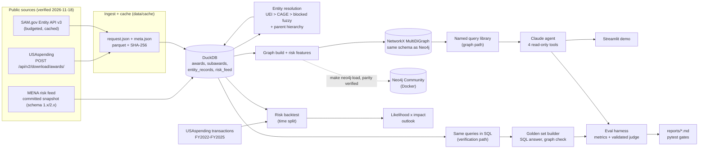

# Design document

> Portfolio project on public data. The customer persona is fictional. Not used by, endorsed by, or built for the
> DoD or any company.

## 1. Architecture

Code map: `ingest/` (pulls and loaders, including transactions), `stage.py` (DuckDB), `er/` (normalize, matcher,
labels, linkage, evaluate, resolve, holdout), `graph/` (schema, build, queries, neo4j_backend), `risk/` (backtest,
report), `agent/` (tools with the grounding guard, agent loop, costs), `evalh/` (golden, challenge, metrics, judge,
run, compare, guard_eval, reports), `site.py` (results page), `app/` (Streamlit).

## 2. Data sources (verified before building)

| Source | What was verified | How it is used |
|---|---|---|
| USAspending `POST /api/v2/download/awards/` | Async job, then status polling, then a zip of CSVs. Filters (`agencies`, `prime_and_sub_award_types`, `time_period`, `psc_codes.require`) and the `columns` subset behave as documented. Column names were checked against a 20-row probe. | One job for DoD toptier, contract types A/B/C/D plus procurement subawards, PSC `J`, 2022-10-01..2025-09-30. 57,596 prime and 35,842 subaward rows. |
| USAspending `spending_by_award_count` | Returned 53,689 contracts for the same filters, fewer than the download's 57,596. Not reconciled: 53,689 equals the number of downloaded awards that have a place-of-performance country (57,596 - 3,907 without one), which suggests a filter difference, but this was not confirmed. | Sanity check only; the download is authoritative here. |
| USAspending `POST /api/v2/download/transactions/` | Verified with a 100-row probe: `award_type_codes` must be passed directly (`prime_and_sub_award_types` is ignored and expands to every award type); the `columns` subset is honoured; `action_type_code` carries terminations (E default, X cause, F convenience) and N legal cancellation. | Risk backtest outcome labels: 187,320 transactions, FY2022-FY2025, same agency/PSC/award-type scope. |
| SAM.gov Entity API v3 | Works with the personal key; `ueiSAM=[a~b~...]` returns up to 10 entities per call. Personal keys can be limited to about 10 calls/day. | 67 subawardee entities enriched (CAGE, legal name, address), cached per call; `make sam` adds more within the daily limit. |
| MENA risk feed | The producer's `SCHEMA.md` is now 2.0.0 (`v2/`, migration note `docs/feed_v2_migration.md` in that repo): `p_escalation` forecasts a UCDP-defined escalation (`label = escalated_next4w_ucdp`; kappa 0.48 against v1's ACLED label), `skill_status = beats_base_rate`, and each file holds about 12 weeks per country. v1 (ACLED label) is closed history and must not be joined to v2. The path in `.env` (`.../v1/latest`) resolves through `latest.json`, whose sha256 is checked. | `make feed-snapshot` copies the validated feed into `data/feeds/mena/` (pinned, committed); `make stage` reads the snapshot. Validated: schema major 1 or 2, `skill_status` required from 1.1, ISO3, Monday weeks, p in [0, 1], <= 5 drivers. The latest week per country joins to Country nodes. |

Data quirks handled: subaward place-of-performance codes mix ISO alpha-2 and alpha-3 (normalized with
`pycountry`); DoD program code `000` means "none"; 686 subawards reference prime awards outside the window and are
dropped from the graph (counted in `reports/graph_summary.json`); a few awards have negative obligations
(de-obligations), which are floored at zero for shares.

## 3. Entity resolution

* **Order:** exact UEI, then CAGE-to-UEI (only when the CAGE maps to exactly one UEI), then blocked fuzzy matching
  (blocking keys: first core-name token, first two tokens, longest token plus state, ZIP5 plus name prefix). A fuzzy
  match is accepted only when its best candidate clears the dev-tuned threshold and beats the runner-up by more
  than 0.02. Otherwise the record stays unresolved under a `NOID-` id.
* **Matcher:** core-name similarity (legal suffixes stripped, common words abbreviated, token-set tempered for short
  subsets), address token similarity, ZIP5, city, state and country, with weights renormalized when fields are
  missing and a penalty for hard geographic contradictions. Its input type has **no identifier fields**.
* **Labels (automatic):** identifier positives (same UEI, differing strings), hard negatives (similar names,
  different UEI and different ultimate parent), synthetic perturbations (abbreviation, punctuation, suffix, typo,
  address reformat, case, acronym, dropped word). Pairs with identical normalized name and address under different
  UEIs are excluded as ambiguous and counted. The split is by UEI hash; the threshold is tuned on dev, and results
  are reported on test.
* **Acronyms:** a single-token name equal to the initials of another (variants include legal suffixes, THE, and
  '&' read as A) counts as strong name evidence; geography must still agree. Acronym recall 0.099 -> 1.000.
* **Learned evidence weights** (`er/linkage.py`): an L2 logistic regression on the agreement evidence (raw name
  similarity, acronym indicator, address, ZIP, city, state, country, each with a missing-value indicator), fitted on
  dev. It is the supervised counterpart of Fellegi-Sunter weights, appropriate because automatic labels exist. It was
  selected over the hand-set weights on dev F1 (0.952 vs 0.945). Test: higher precision, lower recall on identifier
  pairs (fewer false merges). Caveat: weights inherit label artifacts (a missing state gets a positive weight).
* **Blocking:** name keys, plus an acronym key and a **facility key** (normalized street + ZIP5). Defense suppliers
  are often renamed or acquired while keeping the facility, and name keys never paired those records.
* **End-to-end test** (`er/holdout.py`): 620 real records whose name differs from their UEI's canonical record are
  resolved with the identifier withheld, plus 500 records whose company was removed from the index. Correct links
  55.8% (v1) -> 82.7%; wrong links 5.32% -> 3.55%; absent-company false links 7.0% -> 8.4%. Pairwise scores above 0.9
  had hidden this gap.
* **Operating point** (`er/holdout.py` `tradeoff`): the rise in absent-company false links was the price of facility
  blocking. A 140-point grid over the link threshold, the runner-up margin and a stricter threshold for address-only
  candidates was scored by a rule fixed beforehand (correct-link rate minus 2 x false-merge rates: a false merge
  silently corrupts two companies, a miss leaves a visible `NOID-` record). Chosen on a hash-split tuning half,
  reported on the other half: threshold 0.70, margin 0.20 cut absent false links 8.7% -> 4.4% and wrong links
  3.8% -> 0.6%, for 83.6% -> 78.5% correct links. The address-only abstain rule never won; a clearer winner (wider
  margin) did. Weights 1 and 3 choose the same threshold. Shipped in `reports/er_operating_point.json`.
* **Result:** see `reports/entity_resolution.md`. In this scope every record has a UEI, so the fuzzy path matters
  for the agent's name lookup and for data without identifiers, not for batch resolution.

## 4. Graph model

Nodes: `Supplier(supplier_id=UEI)`, `ParentCompany(parent_uei)`, `Award(award_id)`, `Office(office_code)`,
`Country(iso3)`, `ProductServiceCode(psc)`. Edges: `AWARDED_TO` (Award to Supplier), `SUBCONTRACTS_TO`
(prime Supplier to sub Supplier, one edge per subaward, carrying `prime_award_id`, amount and PoP country),
`SUBSIDIARY_OF`, `PERFORMED_IN`, `AWARDED_BY`, `CATEGORIZED_AS`. Every node and edge has `prov_source`,
`prov_pulled_at`, `prov_request_key`. Supplier links also carry `prov_method` (the ER method).

**Risk features** (`supplier_risk` table, copied onto Supplier nodes):

| Feature | Definition |
|---|---|
| Office concentration | max over offices with >= $1M in scope of (supplier obligations from office / office total). Flag `concentrated` if >= 25%. |
| Sole-source share | obligations on awards with extent-competed code B, C, G or NDO / total prime obligations. Flag `sole_source` if >= 50%. |
| Dependent offices | distinct offices paying the supplier directly, plus offices whose awards it subcontracts on. |
| Centrality | PageRank on the undirected simple projection of the whole graph (plus percentile). |
| Foreign / feed exposure | prime and subaward amounts by place-of-performance country; share outside the USA; feed countries touched; max and exposure-weighted `p_escalation` (latest week; context unless the backtest gate adopts it, see the skill policy below). Flag `geo_exposed` if foreign share >= 25% or any feed-country exposure: an impact attribute. |

### Country-risk skill policy

The MENA feed publishes `skill_status`, the result of its producer's forward evaluation. Skill is necessary but
not sufficient: a feed input reaches the termination-likelihood model only if this project's own backtest shows it
helps. The rule (`risk/backtest.py`, `FEED_FEATURES`), fixed before the schema 2.0.0 run:

1. **Skill:** `skill_status` is `beats_base_rate` or `beats_country_rate` (`risk_feed.likelihood_allowed`). Missing
   (schema 1.0.x) counts as not demonstrated.
2. **Point in time:** for feature year t, only feed rows with `data_cutoff` on or before 30 Sep of FY t, at most 26
   weeks old. A value must exist for at least 80% of feed-exposed supplier-years in every train and test year.
   Using a later forecast on an earlier supplier-year would leak the future into the test.
3. **Improvement:** current model plus the candidate vs the current model on the primary split: paired-bootstrap
   average-precision gain with a 95% CI above 0, and a mean AUC gain of at least 0.

**Result with feed v2 (2026-11-19):**
* `p_escalation`: **not adopted.** Skill passes (`beats_base_rate`), but the feed's weeks are 2026-08-24 to
  2026-11-09, after every feature year (FY2022-FY2024), so point-in-time coverage is 0%. The backtest cannot test it,
  so it stays context. It becomes testable once the producer publishes forecasts that cover feature years.
* Feed-country exposure (a static region indicator): evaluable, **not adopted**: AP gain -0.0004 [-0.0073, 0.0071].
* The likelihood model and every backtest number are unchanged.

Shown to users, all tested (`tests/test_risk_feed.py`):
* The app banner states the schema, label, skill status and whether the feed drives the likelihood score (read from
  the backtest's decision, `risk_feed.feed_in_likelihood`); `max_p_escalation` is labelled accordingly.
* The agent's `country_risk` tool and `country_exposure` query return the status. Any answer that used an escalation
  number gets a deterministic caveat appended by the application if the model didn't state the skill status itself
  (`agent.skill_caveat`), so the caveat never depends on the model remembering.
* Schema 2.x is accepted when it carries `skill_status`; its `label` column is carried through as `feed_label`. A
  newer `v<N>/` folder next to the configured one is reported as a notice, never followed silently: a new label means
  a new meaning, so switching is a reviewed change. The switch to v2 was made that way on 2026-11-19 (`make
  feed-snapshot stage er graph backtest`, then the 8 changed questions re-asked). The snapshot replaces v1 rather
  than appending to it, as the producer requires.

**Blast radius (two hops):** hop 1 = awards the supplier holds as prime plus prime awards it subcontracts on; hop 2
= the offices, programs and prime contractors attached to those awards.

### Risk backtest (`risk/backtest.py`, `reports/risk_backtest.md`)

Do the flags anticipate disruption? The unit is a supplier-year, with features from year-t transactions only. The
outcome is any termination or cancellation in t+1. Train on FY2022-FY2023 and test on FY2024 -> FY2025; an earlier
split and a run without the dominant office check stability. Baselines are contract count, prior terminations and
the untrained flag count. Results: the flags rank likelihood worse than contract count (AUC 0.635 vs 0.758). Their
size-adjusted odds ratios are null (concentrated, geo without the Japan cluster) or protective (sole-source 0.66). A
logistic model improves average precision over size (+0.069, CI excludes 0) but not AUC. **Decision:** the flags
stay as impact screens, and likelihood is shown on a separate axis (`supplier_disruption_score`, app tab, site).

## 5. Query library

Ten named, parameterized, read-only queries (`graph/queries.py`): `supplier_profile`, `dependent_offices`,
`blast_radius`, `sole_source_suppliers_by_country`, `office_concentration`, `program_suppliers`, `country_exposure`,
`parent_subsidiaries`, `subcontractors_of`, `office_flagged_suppliers`. Each has a **graph** implementation
(serving) and an independent **SQL** implementation (verification) returning the same canonical shape. Exact
agreement is tested for every query.

## 6. Agent

* Manual tool-use loop on the Messages API (beta endpoint, for the server-side refusal fallback). The client is
  `anthropic.Anthropic()` with no arguments. Model `claude-opus-5-5`, effort `low`, adaptive thinking (always on for
  this model), automatic prompt caching, max 8 steps. Thinking blocks are passed back unchanged.
* Tools: `resolve_supplier`, `run_query` (enum of named queries), `country_risk`, `award_details`. No free-form SQL
  or Cypher generation.
* Output contract: short prose with inline `[award:...]`, `[supplier:...]` citations, then a JSON block
  `{answerable, answer, citations}`. The eval scores the JSON deterministically.
* Observability and cost: per-run JSONL logs (prompt, tool calls with I/O and latency, tokens, cost, served model)
  and a committed spend ledger with a pre-call budget guard.
* **Grounding guard** (in `resolve_supplier`): lists query words the best-matching supplier name lacks (typos,
  abbreviations and legal suffixes still match). If the top candidate lacks any, the tool says so and tells the model
  not to substitute silently. It was added after the challenge set showed Haiku answering for look-alike companies.
  Haiku's near-miss traps went from 1-3 of 8 to 7-8 of 8, with no loss on answerable questions. It is on by
  default; `RESOLVER_GUARD=0` reproduces the unguarded tool.

## 7. Evaluation

The golden set is template-generated (101 questions, 13 unanswerable). Answers come from the SQL path and are
verified by the graph path; disagreements are dropped and logged. Metrics: answer correctness, correct-refusal rate,
citation precision (exists and grounded in that run's tool output), required-citation hits, tool-call
correctness (with declared equivalent queries), steps, cost and latency. An LLM judge is used only for prose quality,
after validation on known-good and corrupted answers (blatant: 40/40; subtle corruptions of real agent prose: 30/30).
Everything runs as pytest gates; see `reports/eval_report.md`.

**Challenge set and comparison** (`evalh/challenge.py`, `evalh/compare.py`, `reports/comparison.md`): 38 harder
answerable questions (comparisons, set intersections, row filters, ratios, parent rollups, acronyms) and 14 traps
(near-miss names, false premises, uncovered countries). Configurations: Opus with tools, Haiku with tools (3 runs),
Haiku with tools and the guard (3 runs), and Opus with no tools. The first draft saturated and was revised once; this
is disclosed. Scorer fixes: a feed-country answer must cite the country, and an "equivalent" query counts only if
the expected entity appears in its output.

## 8. Decisions and rejected alternatives

| Decision | Chosen | Rejected and why |
|---|---|---|
| Data access | One bulk download job with a column subset | Paginating `spending_by_award` (100 rows/page, about 600 pages, missing extent-competed and parent fields); `bulk_download` (no PSC filter). |
| Store | DuckDB for staging and analytics | Postgres (needs a service; DuckDB is enough at 100k rows and keeps the repo self-contained). |
| Graph backend | NetworkX with the Neo4j schema; loader ready | Neo4j-only (Docker was not running; blocked the thin slice). Keeping the schema identical makes the swap mechanical. |
| Answer verification | Two independent implementations (graph traversal vs SQL) | Trusting one implementation; "verifying" with the same code path. |
| Agent query surface | Named, parameterized queries only | Text-to-Cypher/SQL: harder to make read-only-safe and to evaluate, and a bigger hallucination surface. Deferred to a later version behind the same eval. |
| ER evaluation | Identifier-derived plus synthetic labels; identifiers hidden from matcher | Manual labeling (policy: none); evaluating on pairs the matcher can solve by reading the UEI. |
| Risk flags | Simple, explainable thresholds | A learned risk score: no outcome labels exist for "supplier failure" in public data. |
| Judge | Validated before use, prose quality only | LLM-graded correctness: deterministic scoring is possible and cheaper, so the judge isn't needed there. |
| Model | `claude-opus-5-5` at low effort with caching | Haiku 5.5 (measured: 1/49 of the cost per question, equal on structured questions, worse on near-miss names without the guard). With the guard, Haiku is a credible cheaper option; Opus stays the default because its single-run results are the strongest. |
| ER weights | Learned evidence weights, selected on dev F1 | Hand-set weights (kept as an ablation); unsupervised Fellegi-Sunter EM (not needed: automatic labels exist). |
| Name-grounding fix | In the tool (guard in the resolver) | Prompt changes: harder to test, model-specific, and they would have invalidated the comparison. |
| Risk ranking | Flags as impact, a separate likelihood model | Treating the flag count as risk: the backtest shows it ranks likelihood worse than contract count. |

## 9. Limits

* Obligations are lifetime totals on awards with FY2023-FY2025 activity, not FY-bounded spend.
* Subaward reporting (FSRS/SAM) is incomplete: only 2,166 of 57,596 in-scope prime awards (3.8%) have reported subawards, so
  indirect dependencies are a lower bound.
* "Concentrated" and "sole-source" flags fire for most large OEM sustainment suppliers: in the data, 86.75% of
  obligations go to a supplier with at least one flag (`reports/graph_summary.json`). The backtest confirms they are
  impact screens, not likelihood rankings.
* The MENA feed (schema 2.0.0, UCDP label, model 6268b40) reports `skill_status = beats_base_rate`, but has no
  forecasts for the backtest's feature years, so its probabilities stay context (see *Country-risk skill policy*).
* Neo4j parity verified (counts and a Cypher blast radius); serving still uses NetworkX. SAM enrichment is partial
  (67 entities; `make sam` adds more within the daily limit).
* The disruption label is a proxy (terminations for convenience dominate; one office drives 17%-38% of events).
